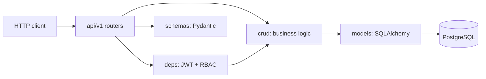
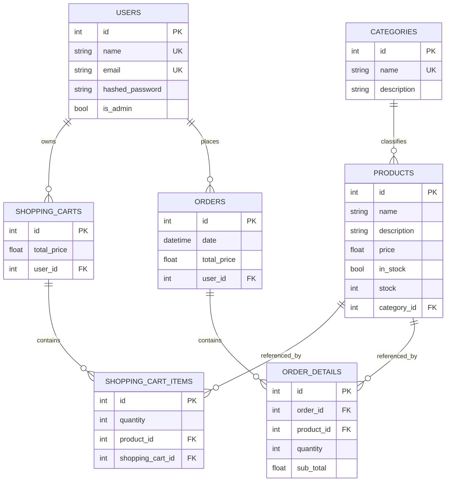

# E-commerce API

A layered REST API for e-commerce operations built with **FastAPI**, **SQLAlchemy 2.0** and **PostgreSQL**. It covers JWT authentication, role-based access control, product and category management, a persistent shopping cart, and a transactional checkout that converts carts into orders while keeping inventory consistent.

> **Project status:** backend-only, feature-complete for the current scope (catalog → cart → checkout → order history). Payments, shipping, order lifecycle states and a frontend are intentionally out of scope. See [AUDIT.md](AUDIT.md) for the technical audit and the remediation backlog.

---

## Table of contents

- [Scope](#scope)
- [Tech stack](#tech-stack)
- [Architecture](#architecture)
- [Project structure](#project-structure)
- [Data model](#data-model)
- [Authentication and authorization](#authentication-and-authorization)
- [Checkout semantics](#checkout-semantics)
- [API reference](#api-reference)
- [Configuration](#configuration)
- [Local setup](#local-setup)
- [Database migrations](#database-migrations)
- [Testing](#testing)
- [Conventions](#conventions)
- [Known limitations](#known-limitations)
- [Roadmap](#roadmap)
- [License](#license)

---

## Scope

### In scope (implemented)

| Capability | Description |
|---|---|
| Authentication | OAuth2 password flow, JWT bearer tokens, bcrypt password hashing |
| Authorization | Two roles: anonymous/public and authenticated; `is_admin` gates write operations |
| Users | Admin-only user creation and listing; self profile endpoint |
| Catalog | Full CRUD for categories and products, with price, availability flag and integer stock |
| Cart | One cart per user, add/accumulate items, stock-aware quantity validation, remove items, computed totals |
| Checkout | Converts purchasable cart items into an order, decrements stock, marks products out of stock at zero |
| Orders | Checkout, order detail, and per-user order history with line items |
| Tests | 38 API-level tests running on isolated in-memory SQLite databases |

### Out of scope (not implemented)

- Payment processing, refunds and invoices
- Shipping, addresses, taxes and discounts
- Order status lifecycle (`pending`, `paid`, `shipped`, `cancelled`)
- Public self-registration, password reset, refresh tokens or token revocation
- Product search, filtering, sorting and pagination
- Admin dashboards, notifications, background jobs
- Frontend clients

---

## Tech stack

| Component | Version | Role |
|---|---|---|
| Python | 3.10+ | Runtime |
| FastAPI | 0.141.1 | HTTP framework, dependency injection, OpenAPI |
| Starlette | 1.6.0 | ASGI toolkit (transitive) |
| SQLAlchemy | 2.0.52 | ORM and session management |
| PostgreSQL | 13+ | Primary datastore |
| psycopg2-binary | 2.9.13 | PostgreSQL driver |
| Alembic | 1.20.0 | Schema migrations |
| Pydantic | 2.13.5 | Request/response validation |
| pydantic-settings | 2.15.0 | Environment configuration |
| python-jose | 3.5.0 | JWT encoding/decoding |
| bcrypt | 5.0.0 | Password hashing |
| pytest | 9.2.0 | Test runner |
| httpx | 0.28.1 | Test client transport |

Pinned dependencies live in [`requirements.txt`](requirements.txt).

---

## Architecture

The codebase follows a strict four-layer flow:



| Layer | Directory | Responsibility |
|---|---|---|
| HTTP | `app/api/v1/` | Routing, status codes, HTTP error mapping |
| Dependencies | `app/deps/` | Database session, token validation, admin guard |
| Schemas | `app/schemas/` | Input validation and response contracts |
| Business logic | `app/crud/` | Transactions, stock rules, queries |
| Persistence | `app/models/` | SQLAlchemy mappings and relationships |
| Infrastructure | `app/core/`, `app/db/` | Settings, security primitives, engine/session factory |

Dependency injection is wired through FastAPI:

- `get_db()` provides a request-scoped session and always closes it.
- `get_current_user()` validates the JWT and reloads the user from the database.
- `require_admin()` extends `get_current_user()` with a role check.

---

## Project structure

```text
E-commerce/
├── app/
│   ├── main.py                 # FastAPI app factory and router mounting
│   ├── alembic.ini             # Alembic configuration
│   ├── alembic/
│   │   ├── env.py
│   │   └── versions/           # Migration history
│   ├── api/v1/
│   │   ├── api.py              # Aggregates versioned routers
│   │   ├── auth.py
│   │   ├── carts.py
│   │   ├── categories.py
│   │   ├── orders.py
│   │   └── products.py
│   ├── core/
│   │   ├── config.py           # pydantic-settings configuration
│   │   └── security.py         # JWT + bcrypt helpers
│   ├── crud/
│   │   ├── __init__.py         # Public CRUD surface
│   │   ├── cart.py
│   │   ├── category.py
│   │   ├── order.py
│   │   ├── product.py
│   │   └── user.py
│   ├── db/
│   │   ├── database.py         # Engine, session factory, declarative Base
│   │   └── init_db.py          # Schema bootstrap from models
│   ├── deps/deps.py
│   ├── models/
│   │   ├── category.py
│   │   ├── order.py
│   │   ├── product.py
│   │   └── user.py
│   ├── schemas/
│   │   ├── category.py
│   │   ├── product.py
│   │   ├── token.py
│   │   └── user.py
│   └── tests/
│       ├── conftest.py
│       ├── test_auth.py
│       ├── test_cart.py
│       ├── test_categories.py
│       ├── test_orders.py
│       └── test_products.py
├── .env.example
├── requirements.txt
├── README.md
├── AUDIT.md
└── LICENSE
```

---

## Data model



Notes:

- Order lines store a snapshot of `quantity` and `sub_total`, so historical prices are preserved even if the product catalog changes.
- `products.stock` is an integer inventory counter; `products.in_stock` is a manual availability flag. Both must allow a sale (see [Checkout semantics](#checkout-semantics)).
- `shopping_carts.total_price` is denormalized and recomputed by cart operations and checkout.

---

## Authentication and authorization

1. `POST /api/v1/auth/login` accepts `application/x-www-form-urlencoded` credentials (`username` = email, `password`).
2. The password is verified against the bcrypt hash stored in `users.hashed_password`.
3. A signed JWT is returned with `sub` (email), `is_admin`, and `exp`.
4. Clients send `Authorization: Bearer <token>` on protected endpoints.
5. `get_current_user()` decodes the token and reloads the user from the database, so role changes take effect without reissuing tokens.

Authorization rules:

| Operation | Requirement |
|---|---|
| Login | Public |
| List/create users | Admin |
| Current profile | Authenticated |
| List products/categories | Public |
| Create/update/delete products/categories | Admin |
| Cart operations | Authenticated |
| Checkout and order history | Authenticated; orders are scoped to the caller |

Interactive API documentation is available at `/docs` (Swagger UI) and `/redoc`.

---

## Checkout semantics

`POST /api/v1/orders/checkout` runs inside a single database transaction:

1. Load the caller's cart. An empty or missing cart returns `400`.
2. Insert the `Order` and `flush()` it to obtain `order.id` without committing.
3. For every cart item:
   - Skip if the product no longer exists, `in_stock` is `false`, or `price <= 0`.
   - Skip if `quantity <= 0` or `quantity > product.stock`.
   - Otherwise create an `Order_detail` snapshot, accumulate the total, decrement `product.stock`, and mark `in_stock = false` when stock reaches zero.
4. If no item is purchasable, raise `ValueError` → the transaction rolls back, no order is created, the cart is untouched, and the API returns `400`.
5. Remove only the purchased items from the cart, recompute `cart.total_price`, and commit.

Consequences:

- Unpurchasable items remain in the cart so the user can adjust them.
- A partial purchase is represented as an order containing only the successful lines.
- Stock is validated at checkout time, not only when items are added to the cart.

> **Concurrency caveat:** stock checks are not protected by row-level locks. Under parallel checkouts of the same product, overselling is possible. See [AUDIT.md](AUDIT.md) finding **C2**.

---

## API reference

Base path: `/api/v1`. All responses are JSON.

### Authentication

| Method | Path | Auth | Success | Description |
|---|---|---|---|---|
| `POST` | `/auth/login` | Public | `200` | Obtain a JWT |
| `GET` | `/auth/users` | Admin | `200` | List users |
| `POST` | `/auth/users` | Admin | `201` | Create a user |
| `GET` | `/auth/users/me` | Bearer | `200` | Current user profile |

### Categories

| Method | Path | Auth | Success | Description |
|---|---|---|---|---|
| `GET` | `/categories/` | Public | `200` | List categories |
| `POST` | `/categories/` | Admin | `200` | Create a category |
| `PUT` | `/categories/{category_id}` | Admin | `200` | Replace a category |
| `DELETE` | `/categories/{category_id}` | Admin | `200` | Delete a category |

### Products

| Method | Path | Auth | Success | Description |
|---|---|---|---|---|
| `GET` | `/products/` | Public | `200` | List products |
| `POST` | `/products/` | Admin | `200` | Create a product |
| `PUT` | `/products/{product_id}` | Admin | `200` | Replace a product |
| `DELETE` | `/products/{product_id}` | Admin | `200` | Delete a product |

### Cart

| Method | Path | Auth | Success | Description |
|---|---|---|---|---|
| `GET` | `/cart/` | Bearer | `200` | Get the caller's cart with items and totals |
| `POST` | `/cart/add/{product_id}?amount=N` | Bearer | `200` | Add or accumulate an item |
| `DELETE` | `/cart/delete/{item_id}` | Bearer | `200` | Remove an item owned by the caller |

### Orders

| Method | Path | Auth | Success | Description |
|---|---|---|---|---|
| `GET` | `/orders/` | Bearer | `200` | List the caller's orders (newest first) |
| `POST` | `/orders/checkout` | Bearer | `201` | Convert the cart into an order |
| `GET` | `/orders/{order_id}` | Bearer | `200` | Get one of the caller's orders |

Error responses use FastAPI's standard shape:

```json
{ "detail": "Human-readable reason" }
```

Relevant codes: `400` (business rule violation), `401` (missing/invalid token), `403` (insufficient role), `404` (missing or not-owned resource), `422` (schema validation).

### Example: login and checkout

```bash
# 1. Login
curl -X POST http://localhost:8000/api/v1/auth/login \
  -H "Content-Type: application/x-www-form-urlencoded" \
  -d "username=admin@example.com&password=secret"

# { "access_token": "<jwt>", "token_type": "bearer" }

# 2. Add two units to the cart
curl -X POST "http://localhost:8000/api/v1/cart/add/1?amount=2" \
  -H "Authorization: Bearer <jwt>"

# 3. Checkout
curl -X POST http://localhost:8000/api/v1/orders/checkout \
  -H "Authorization: Bearer <jwt>"

# {
#   "id": 1,
#   "date": "2026-11-19T10:00:00",
#   "total_price": 50.0,
#   "details": [{ "product_id": 1, "quantity": 2, "sub_total": 50.0 }]
# }
```

---

## Configuration

Settings are loaded from `.env` at the repository root through `pydantic-settings` (`app/core/config.py`).

| Variable | Type | Description |
|---|---|---|
| `DB_USER` | string | PostgreSQL user |
| `DB_PASSWORD` | string | PostgreSQL password |
| `DB_HOST` | string | PostgreSQL host (default `localhost`) |
| `DB_PORT` | integer | PostgreSQL port (default `5432`) |
| `DB_NAME` | string | Database name |
| `SECRET_KEY` | string | JWT signing secret; use a long random value |
| `ALGORITHM` | string | JWT algorithm, e.g. `HS256` |
| `ACCESS_TOKEN_EXPIRE_MINUTES` | integer | Token lifetime in minutes |

Copy the template and fill it in:

```bash
cp .env.example .env
```

> `.env` is git-ignored. Never commit real credentials or signing keys.

---

## Local setup

### Prerequisites

- Python 3.10+
- PostgreSQL 13+ running locally or reachable over the network
- An empty database created in PostgreSQL

### 1. Install dependencies

```bash
python -m venv venv

# Windows (PowerShell)
venv\Scripts\Activate.ps1
# Linux/macOS
source venv/bin/activate

pip install -r requirements.txt
```

### 2. Configure the environment

```bash
cp .env.example .env
```

Edit `.env` with your database credentials and a strong `SECRET_KEY`.

### 3. Provision the database

```bash
cd app
python -m db.init_db
alembic stamp head
```

`python -m db.init_db` creates the schema from the SQLAlchemy models. `alembic stamp head` marks the database as current so subsequent migrations apply correctly.

> **Important:** running `alembic upgrade head` against a completely empty database does **not** work today, because the early migration revisions are empty stubs while later ones reference tables that were never created (see [AUDIT.md](AUDIT.md) finding **C1**).

### 4. Run the API

```bash
cd app
uvicorn main:app --reload --port 8000
```

- API base URL: `http://localhost:8000/api/v1`
- Swagger UI: `http://localhost:8000/docs`
- ReDoc: `http://localhost:8000/redoc`

---

## Database migrations

Alembic lives in `app/alembic/`. Run commands from the `app/` directory:

```bash
cd app

alembic current                  # applied revision
alembic heads                    # latest revision
alembic revision --autogenerate -m "describe change"
alembic upgrade head
alembic downgrade -1
```

Current head: `d1e2f3a4b5c6` (`stock not null and backfill`).

Known issue: the repository contains three no-op revisions (`b52a76df4fc2`, `c8cea448c4a4`, `602818a4910b`) and later revisions assume `users`, `categories` and `products` already exist. Fresh-database provisioning therefore requires the model bootstrap described above. See [AUDIT.md](AUDIT.md) finding **C1**.

---

## Testing

The suite contains **38 API-level tests** covering authentication, products, categories, cart and orders, including negative paths and authorization boundaries.

```bash
# From the repository root
pytest -q

# One module
pytest app/tests/test_orders.py -v

# By keyword
pytest -q -k "stock"
```

### Test design

| Fixture | Purpose |
|---|---|
| `db_session` | Isolated in-memory SQLite database per test |
| `client` | `TestClient` with `get_db` overridden to the test session |
| `admin_user` / `normal_user` / `other_user` | Seeded users with distinct roles |
| `admin_headers` / `user_headers` / `other_headers` | Automatic login and bearer headers |
| `category` / `product` | Ready-to-use catalog fixtures |

Characteristics:

- No test touches the real PostgreSQL database.
- Tokens are generated automatically per test; nothing is hard-coded.
- Each test starts from a clean schema, so tests are order-independent.

Limitations: SQLite does not enforce foreign keys by default and is not a substitute for PostgreSQL integration or concurrency tests. See [AUDIT.md](AUDIT.md) finding **M11**.

---

## Conventions

| Element | Convention | Example |
|---|---|---|
| SQL tables | plural, snake_case | `order_details` |
| ORM classes | singular, PascalCase | `Order` |
| Pydantic schemas | singular, PascalCase, `*Create` / `*Response` | `ProductCreate` |
| CRUD modules | singular, matching the model | `crud/order.py` |
| Router modules | plural, matching the HTTP resource | `api/v1/orders.py` |
| URL collections | plural | `/orders/` |

Legacy exceptions to PEP 8 names (`Shopping_cart`, `Shopping_cart_item`, `Order_detail`) are documented in the audit; renaming them would require a coordinated model + migration change.

---

## Known limitations

The full audit is in [AUDIT.md](AUDIT.md). Highest-impact items:

1. **Migration baseline is incomplete** — a fresh database cannot be built with `alembic upgrade head` alone.
2. **Checkout is not concurrency-safe** — no row locking around stock validation/decrement.
3. **Money uses floating point** (`double precision` / `Float`) instead of `NUMERIC`.
4. **Missing database constraints** — cart uniqueness per user, unique cart lines, `CHECK` on price/stock/quantity, and foreign-key indexes.
5. **Validation gaps** — negative prices/stock and weak passwords are accepted.
6. **API contract inconsistencies** — cart and order responses are ad-hoc dictionaries without response models; create endpoints return `200` instead of `201`.

---

## Roadmap

Prioritized next steps:

1. Rebuild the Alembic history so a fresh database is reproducible (P0).
2. Make checkout concurrency-safe with `SELECT ... FOR UPDATE` or atomic conditional updates (P0).
3. Migrate monetary columns to `NUMERIC(12, 2)` and use `Decimal` (P1).
4. Add DB constraints and FK indexes (P1).
5. Add Pydantic validators and a password policy (P1).
6. Introduce response models for cart and orders, unify status codes, add pagination (P2).
7. Add order status, shipping address and payment abstraction (P2).
8. Add PostgreSQL integration tests, CI pipeline and coverage reporting (P2).
9. Add CORS, rate limiting, security headers and structured logging (P2).

---

## License

Released under the [MIT License](LICENSE). Copyright (c) 2026 Yorber Rojas.
